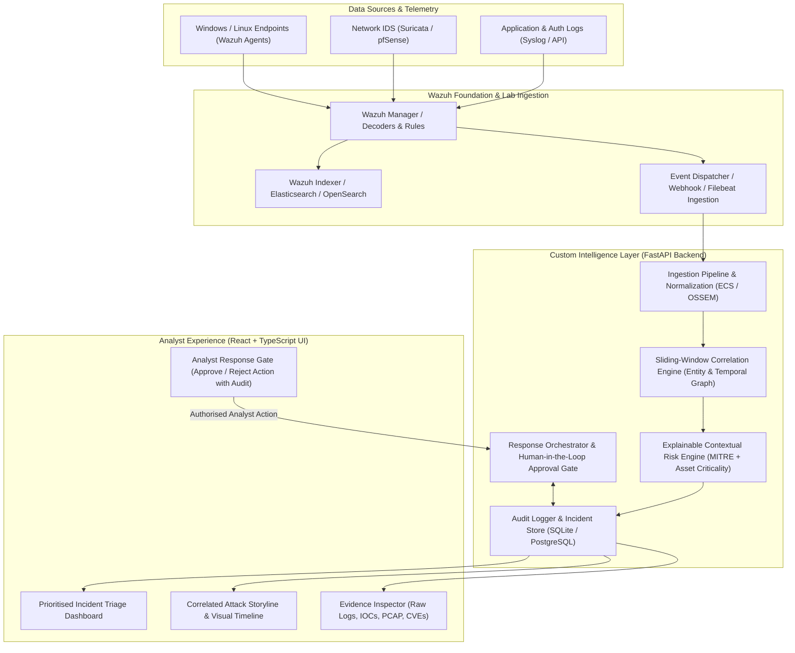

# Implementation Plan: Open-Source Intelligent Cybersecurity Monitoring, Threat Detection & Incident Response Platform

> **Project Reference**: Hackathon Wazuh-based Open-Source Contribution  
> **Core Objective**: Transform noisy, disconnected security alerts (endpoints, networks, applications) into correlated, prioritised incidents with explainable risk scoring, and empower SOC analysts with human-in-the-loop approved response workflows.

---

## 1. System Architecture & Component Overview



---

## 2. Directory Layout (Monorepo)

```
Cybersecurity_Technology_Package_Hackathon/
├── README.md
├── IMPLEMENTATION_PLAN.md
├── docker-compose.yml                  # Full stack: backend, frontend, mock-wazuh/lab
├── backend/                            # Python + FastAPI Intelligence Engine
│   ├── app/
│   │   ├── __init__.py
│   │   ├── main.py                     # App entry point & CORS
│   │   ├── core/
│   │   │   ├── config.py               # Env vars, thresholds, risk weights
│   │   │   └── security.py             # Auth & RBAC (Analyst, Admin)
│   │   ├── models/                     # SQLAlchemy Models
│   │   │   ├── alert.py
│   │   │   ├── incident.py
│   │   │   ├── action.py
│   │   │   └── audit.py
│   │   ├── schemas/                    # Pydantic Schemas (API contracts)
│   │   │   ├── alert.py
│   │   │   ├── incident.py
│   │   │   ├── risk.py
│   │   │   └── response.py
│   │   ├── services/
│   │   │   ├── ingestion.py            # Normalized parser for Wazuh/Suricata
│   │   │   ├── correlation.py          # Sliding-window & entity graph correlator
│   │   │   ├── risk_scorer.py          # Explainable multi-factor scoring algorithm
│   │   │   ├── threat_intel.py         # MITRE ATT&CK & CVE contextualizer
│   │   │   └── response_manager.py     # Approval workflow & response execution
│   │   ├── api/
│   │   │   └── v1/
│   │   │       ├── alerts.py
│   │   │       ├── incidents.py
│   │   │       ├── responses.py
│   │   │       └── metrics.py
│   │   └── tests/
│   │       ├── test_correlation.py
│   │       ├── test_risk_scorer.py
│   │       └── test_response_workflow.py
│   ├── requirements.txt
│   └── Dockerfile
│
├── frontend/                           # React + TypeScript + Vite + Tailwind CSS
│   ├── src/
│   │   ├── components/
│   │   │   ├── layout/                 # Navbar, Sidebar, Status Header
│   │   │   ├── incidents/              # IncidentTable, IncidentCard, SeverityBadge
│   │   │   ├── timeline/               # AttackTimeline, EventSequenceViewer
│   │   │   ├── risk/                   # ExplainableRiskCard, FactorBreakdown
│   │   │   ├── response/               # ResponseApprovalModal, ActionHistory
│   │   │   └── common/                 # Modals, Tooltips, Buttons
│   │   ├── pages/
│   │   │   ├── Dashboard.tsx           # High-level overview & triage
│   │   │   ├── IncidentDetail.tsx      # Deep dive, timeline, evidence & response
│   │   │   ├── AuditLog.tsx            # SOC accountability log
│   │   │   └── MetricsPage.tsx         # Precision, Recall, Latency stats
│   │   ├── services/                   # API client (Axios / TanStack Query)
│   │   ├── types/                      # TypeScript definitions matching Backend schemas
│   │   └── App.tsx
│   ├── package.json
│   ├── vite.config.ts
│   └── tailwind.config.js
│
├── lab_simulation/                     # Network & Threat Generation Lab
│   ├── scenarios/
│   │   ├── scenario_1_account_takeover.json # Failed logins -> SSH in -> exfil
│   │   ├── scenario_2_ransomware_prep.json  # Suspicious PowerShell -> File modification
│   │   └── scenario_3_benign_noise.json     # Normal admin activity (test false-positives)
│   ├── generators/
│   │   ├── attack_simulator.py         # Replays realistic multi-stage telemetry
│   │   └── pfsense_suricata_feed.py    # Generates network logs & PCAP extracts
│   └── test_fixtures/
│       └── wazuh_alerts_sample.json
│
└── upstream_contributions/             # Open Source Wazuh PR Artifacts
    ├── issue_41226_pfsense_decoder/    # Target Issue: pfSense firewall decoder UDP/TCP/IPv6
    │   ├── test_samples/               # Real filterlog samples including IPv6 & UDP
    │   ├── updated_decoders.xml        # Improved regex & port extraction
    │   └── test_runner.py              # Regression test script verifying fix
    └── README.md
```

---

## 3. Core Data Contracts & Schemas

### 3.1 Normalized Alert Schema
```json
{
  "alert_id": "wazuh-1029384",
  "source": "wazuh",
  "timestamp": "2026-11-13T12:00:10Z",
  "agent": {
    "id": "001",
    "name": "prod-db-server",
    "ip": "192.168.10.50"
  },
  "rule": {
    "id": "5503",
    "level": 10,
    "description": "User authentication failure multiple times",
    "mitre": {
      "id": ["T1110"],
      "tactic": ["Credential Access"],
      "technique": ["Brute Force"]
    }
  },
  "data": {
    "src_ip": "203.0.113.45",
    "dst_port": 22,
    "user": "dbadmin"
  },
  "raw_log": "Nov 13 12:00:10 prod-db-server sshd[1234]: Failed password for dbadmin from 203.0.113.45 port 54321 ssh2"
}
```

### 3.2 Correlated Incident Schema with Explainable Risk
```json
{
  "incident_id": "INC-20261113-001",
  "title": "Suspected Credential Compromise & Exfiltration on prod-db-server",
  "status": "OPEN",
  "created_at": "2026-11-13T12:05:00Z",
  "primary_entity": {
    "entity_type": "HOST_AND_USER",
    "entity_id": "prod-db-server::dbadmin",
    "ip": "192.168.10.50"
  },
  "risk_assessment": {
    "overall_score": 87,
    "severity": "CRITICAL",
    "confidence": 0.92,
    "factors": [
      {
        "factor": "Multi-Stage Attack Chain Detected",
        "weight": 35,
        "detail": "Observed 3 sequential attack stages: Brute Force (T1110) -> Account Access (T1078) -> Data Exfiltration (T1048)."
      },
      {
        "factor": "High-Value Asset",
        "weight": 25,
        "detail": "Target asset 'prod-db-server' is tagged as Critical Data Store (contains customer PII)."
      },
      {
        "factor": "Unusual Source Geolocation/IP",
        "weight": 15,
        "detail": "Authentication originated from unrecognized external IP (203.0.113.45)."
      },
      {
        "factor": "Volume Anomaly",
        "weight": 12,
        "detail": "450 MB outbound transfer to unknown external endpoint within 3 minutes of login."
      }
    ]
  },
  "attack_timeline": [
    {
      "step": 1,
      "stage": "Initial Access / Credential Access",
      "timestamp": "2026-11-13T12:00:10Z",
      "alert_id": "wazuh-1029384",
      "summary": "15 failed SSH attempts for 'dbadmin' from 203.0.113.45"
    },
    {
      "step": 2,
      "stage": "Execution / Valid Accounts",
      "timestamp": "2026-11-13T12:02:15Z",
      "alert_id": "wazuh-1029390",
      "summary": "Successful SSH login for 'dbadmin' from same external IP"
    },
    {
      "step": 3,
      "stage": "Collection / Sensitive Data",
      "timestamp": "2026-11-13T12:03:40Z",
      "alert_id": "wazuh-1029412",
      "summary": "Read access to /var/data/customers.db by process sshd"
    },
    {
      "step": 4,
      "stage": "Exfiltration",
      "timestamp": "2026-11-13T12:04:30Z",
      "alert_id": "suricata-88401",
      "summary": "Suricata alert: High outbound TLS stream (450MB) to 203.0.113.45"
    }
  ],
  "recommended_actions": [
    {
      "action_id": "ACT-ISO-01",
      "name": "Isolate Endpoint",
      "description": "Trigger Wazuh active response to drop all network connections except management.",
      "requires_approval": true,
      "target": "prod-db-server (192.168.10.50)"
    },
    {
      "action_id": "ACT-REV-02",
      "name": "Revoke User Session & Disable Account",
      "description": "Kill active SSH session for dbadmin and temporarily disable account.",
      "requires_approval": true,
      "target": "dbadmin"
    }
  ]
}
```

---

## 4. Four-Agent Division & Execution Plan

```
Agent 1: Network Security & Lab Infrastructure
Agent 2: Detection, Threat Intelligence & Upstream Wazuh Contribution
Agent 3: Intelligence Backend, Correlation Engine & Risk Scorer
Agent 4: SOC Analyst Dashboard & QA Validation
```

### Agent 1: Network Security & Lab Infrastructure
* **Focus**: Network telemetry, packet data, Suricata integration, and realistic multi-stage test simulations.
* **Core Deliverables**:
  1. **Docker Compose Lab Setup**:
     - Stand up a lightweight environment or mock Wazuh Manager endpoint that streams security alerts to the intelligence backend.
     - Provide Suricata/pfSense log ingestion pipeline.
  2. **Automated Threat Scenario Simulator (`lab_simulation/generators/attack_simulator.py`)**:
     - *Scenario 1 (Account Takeover & Exfil)*: Password guessing -> successful authentication from external IP -> sensitive file read -> spike in outbound bandwidth.
     - *Scenario 2 (Ransomware / Unauthorized File Tampering)*: Suspicious curl/PowerShell download -> high-frequency file modifications in critical directories.
     - *Scenario 3 (Benign Background Activity)*: Normal routine administrative SSH, package updates, daily backup script (to evaluate false positive rate).
  3. **Packet Capture & Network Telemetry Fixtures**:
     - Provide sample PCAP extract or parsed NetFlow metadata to support deep-dive investigation.

---

### Agent 2: Detection, Threat Intelligence & Upstream Contribution
* **Focus**: Threat classification, MITRE ATT&CK mapping, Wazuh decoder/rule tuning, and genuine open-source patch.
* **Core Deliverables**:
  1. **MITRE ATT&CK & Threat Context Engine**:
     - Rule mapping table connecting raw Wazuh Rule IDs and Suricata SIDs to MITRE Tactics & Techniques.
     - Asset criticality database (identifying DB servers, domain controllers, endpoints, and their base risk multiplier).
  2. **Upstream Wazuh Open-Source Contribution (Candidate A: Issue #41226)**:
     - Target: pfSense firewall decoder fails to parse UDP/TCP ports consistently and misses IPv6 lines.
     - Build a standalone regression suite: `upstream_contributions/issue_41226_pfsense_decoder/test_runner.py`.
     - Implement the corrected decoder XML regex in `updated_decoders.xml`.
     - Provide ready-to-submit PR documentation, diff, and maintainer explanation.
  3. **Vulnerability & CVE Correlation Helper**:
     - Mock vulnerability inventory (linking outdated software on endpoints to known CVEs) to feed into Agent 3's risk calculation.

---

### Agent 3: Intelligence Backend, Correlation Engine & Risk Scorer
* **Focus**: High-performance FastAPI backend, event ingestion, sliding-window correlation, explainable risk calculations, and safe response state machine.
* **Core Deliverables**:
  1. **FastAPI Foundation & Database Models**:
     - SQLite/PostgreSQL schema: `Alerts`, `Incidents`, `IncidentEvents`, `ResponseActions`, `AuditLog`.
     - REST API endpoints for ingestion, listing incidents, timeline inspection, and response action approvals.
  2. **Sliding-Window Correlation Engine (`app/services/correlation.py`)**:
     - Sliding temporal window (e.g., configurable 15-minute window).
     - Entity grouping heuristics:
       - Match by common `agent_id` or host IP.
       - Match by common `user` identity across endpoints.
       - Match by external source IP (`src_ip`).
       - Progression link: Credential Access -> Execution -> Persistence/Collection -> Exfiltration.
  3. **Explainable Risk Scoring Algorithm (`app/services/risk_scorer.py`)**:
     - Multi-factor formula:
       $$\text{Score} = \min(100, (\text{Base Severity} \times W_s) + (\text{Asset Criticality} \times W_a) + (\text{Chain Length Multiplier} \times W_c) + \text{Context Penalties})$$
     - Returns not just a number, but a **human-readable array of factors** with weights, directly answering: *"Why was this prioritised?"*
  4. **Human-in-the-Loop Safe Response System (`app/services/response_manager.py`)**:
     - No disruptive action can run autonomously.
     - Endpoints: `POST /api/v1/incidents/{id}/actions/{action_id}/approve` and `/reject`.
     - Audit log recorder tracking analyst identity, timestamp, action type, and reason.

---

### Agent 4: SOC Analyst Dashboard & QA Validation
* **Focus**: High-quality React + TypeScript web application for the security analyst, plus end-to-end testing and presentation assets.
* **Core Deliverables**:
  1. **Modern Incident Triage Dashboard**:
     - Prioritised incident queue showing severity, risk score, target entity, status, and elapsed time.
     - Filter by severity (Critical, High, Medium, Low) and status (Open, Under Review, Contained, False Positive).
  2. **Incident Deep-Dive & Visual Attack Timeline**:
     - Step-by-step visual sequence of the attack showing timestamp, tactic badge, description, and source/destination indicators.
     - Explainable Risk Score Breakdown widget (visual bars showing contributing factors).
     - Raw Alert & Log Inspector drawer for forensics and verification.
  3. **Analyst Action Center & Human-in-the-Loop Modal**:
     - Action buttons: "Isolate Endpoint", "Revoke Credentials", "Mark as False Positive", "Resolve Incident".
     - Confirmation modal requiring analyst notes/reason before dispatching approval.
     - Immutable Audit Trail view showing past approvals and SOC operator history.
  4. **QA & Hackathon Success Metrics Dashboard**:
     - Displays live calculated metrics: Precision, Recall, False-Positive Rate, Average Correlation Latency.
     - End-to-end integration test runner validating that simulated alerts immediately trigger the expected incident.

---

## 5. Development Phases & Execution Roadmap

| Phase | Duration / Step | Key Objective | Responsible Agent(s) |
|---|---|---|---|
| **Phase 1: Environment & Project Scaffolding** | Step 1 | Repository scaffolding, FastAPI setup, React Vite setup, Docker compose. | Agent 1 & Agent 3 |
| **Phase 2: Data Models & Synthetic Telemetry** | Step 2 | Schemas, sample attack datasets (account takeover, exfil, benign), mock alerts. | Agent 1 & Agent 2 |
| **Phase 3: Correlation & Explainable Risk Engine**| Step 3 | Graph correlation algorithm, sliding window, risk factor calculation engine. | Agent 3 |
| **Phase 4: Upstream Wazuh Fix Preparation** | Step 4 | pfSense decoder issue #41226 reproduction test, fixed XML, PR documentation. | Agent 2 |
| **Phase 5: Analyst UI & Visual Storyline** | Step 5 | Incident queue, visual attack timeline, explainable risk card, approval dialogs. | Agent 4 |
| **Phase 6: Integration, E2E Demo & Metrics** | Step 6 | Live simulation playback, precision/recall verification, end-to-end demo rehearsal. | All Agents |

---

## 6. Demonstration & Hackathon Presentation Script

1. **The Hook (Minute 1)**: Show standard Wazuh alerts list—dozens of individual failed login warnings and separate network spikes that overwhelm an analyst.
2. **The Intelligence Layer (Minute 2)**: Run the scenario replay. Watch the custom Python correlation service link the alerts across time and host, consolidating 18 raw logs into **1 High-Risk Incident**.
3. **Explainable AI/Risk (Minute 3)**: Open the incident. Show the SOC analyst exactly *why* it is scored 87/100 (multi-stage attack chain, database server criticality, outbound data volume).
4. **Controlled Response (Minute 4)**: Demonstrate human-in-the-loop safety. Review proposed remediation ("Isolate Endpoint"), click **Approve**, view the generated audit trail.
5. **Open Source Contribution (Minute 5)**: Present the upstream Wazuh pull request / fix for pfSense decoder issue #41226 with regression tests passing.
